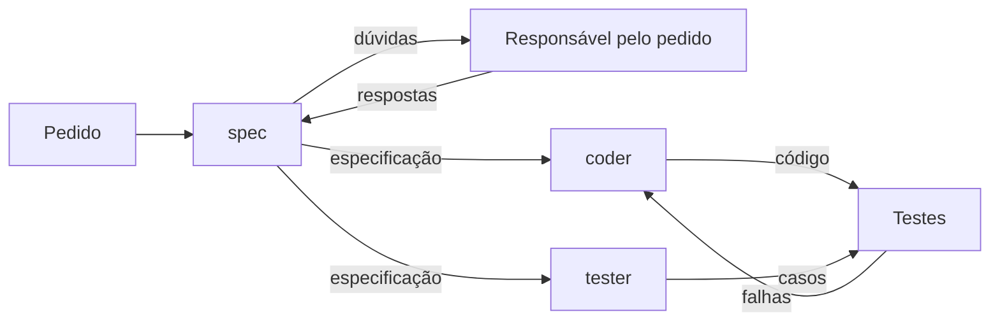
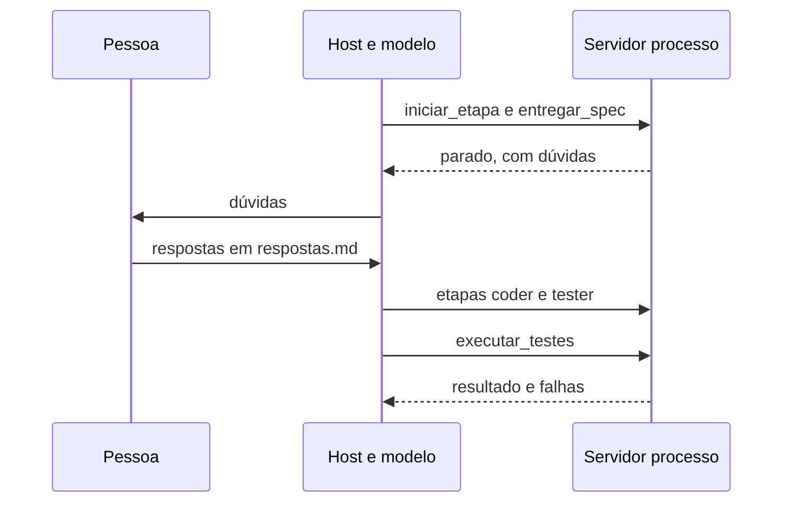

# Processo de software com agentes
## Spec, coder e tester em quatro ferramentas

---

## Um pedido de alteração

O suporte pede uma busca na API de tarefas.

> Filtrar tarefas por estado e por termo no título.

```typescript
filtrarTarefas(
  tarefas: Tarefa[],
  filtro: { estado: string, termo?: string }
): Tarefa[]
```

Estados aceitos são `todas`, `abertas` e `concluidas`.

---

## Decisões que o pedido deixa abertas

| Entrada | Resultados possíveis |
|---|---|
| Termo `REVISAR` e título `Revisar código` | Encontra ou ignora |
| Termo `relatorio` e título `Relatório` | Encontra ou ignora |
| Termo só com espaços | Filtra tudo ou não filtra |
| Estado `arquivadas` | Lista vazia ou erro |
| Lista fora da ordem de id | Mantém ou reordena |

Cada linha muda o resultado esperado de um teste.

---

## Implementar com um único prompt

* O modelo escolhe uma resposta para cada decisão aberta e não registra a escolha.
* Os testes saem da mesma resposta que o código e repetem as mesmas escolhas.
* Nenhum documento intermediário permite revisar as decisões antes do código.
* Uma nova execução do mesmo prompt pode decidir de outro jeito.

As quatro condições continuam com qualquer modelo. Elas dependem da organização do trabalho, que é o processo de software.

---

# Processo de software
## Atividades, critérios e verificação

---

## Atividades e artefatos

Um processo de software organiza o trabalho em atividades. Cada atividade recebe artefatos e entrega outros.

| Atividade | Entrega no pedido de filtro |
|---|---|
| Comunicação | Pedido, dúvidas e respostas |
| Modelagem | Especificação com critérios de aceitação |
| Construção | Código e casos de teste |

O artefato de uma atividade é a entrada da seguinte. Ele pode ser revisado antes que a próxima comece.

---

## Critérios de aceitação

Um critério descreve um comportamento com uma entrada e o resultado esperado.

```text
C05. O termo pode aparecer em qualquer parte do título.
C06. Maiúsculas e minúsculas não importam.
     "REVISAR" encontra "Revisar código".
C07. Acentos contam. "relatorio" não encontra "Relatório".
C08. Espaços no começo e no fim do termo são ignorados.
```

C vem de critério, e o número identifica cada um. Cada caso de teste cita o ID do critério que verifica, e um critério sem caso aparece na contagem.

---

## Dúvidas antes do código

Quando o pedido permite dois resultados para uma entrada válida, a dúvida vai para a pessoa responsável pelo pedido.

```text
Dúvida    "relatorio" deve encontrar "Relatório"?
Resposta  Não. Acentos contam.
Critério  C07. Acentos contam. "relatorio" não encontra "Relatório".
```

A resposta fica registrada em `respostas.md` e vale para as próximas especificações. Essa troca é a atividade de comunicação.

---

## Verificação e validação

Verificação confere se o código implementa a especificação.
Validação confere se o código atende ao pedido.

| Pergunta | Compara | Atividade |
|---|---|---|
| Construímos o produto corretamente? | Código e especificação | Verificação |
| Construímos o produto certo? | Código e pedido | Validação |

Uma especificação incompleta deixa passar na verificação um código que falha na validação.

---

## Teste independente

Quem escreve o código tende a testar os caminhos que a implementação já cobre, inclusive os defeitos.

Um grupo independente de teste escreve os casos a partir dos requisitos e da especificação. O desenvolvedor corrige os erros encontrados.

Com agentes, o tester recebe a especificação e não recebe o código.

---

## Testes aprovados, pedido não atendido

Execução com o Gemini, tentativa 2 do coder.

| Suíte | Compara o código com | Resultado |
|---|---|---|
| Casos do tester | Especificação | 5 de 5 |
| Testes de aceitação | Pedido | 4 de 5 |

O spec decidiu que a busca diferencia maiúsculas e não registrou dúvida. Tester e coder seguiram o spec. A verificação aprovou e a validação reprovou.

[Registro da execução](https://github.com/pedrosatin/processo-software-agentes/tree/main/evidencias/2026-10-04-gemini-validacao)

---

# Agentes no processo
## Um papel por agente

---

## Um agente por papel

| Papel | Atividade | Recebe | Entrega |
|---|---|---|---|
| spec | Modelagem | Pedido e respostas | Critérios e dúvidas |
| Responsável | Comunicação | Dúvidas | Respostas |
| coder | Construção | Especificação | Código |
| tester | Construção | Especificação | Casos de teste |
| Testes | Verificação | Código e casos | Resultado |

---

## Mesmo modelo, contextos separados

O modelo responde a partir do que está na janela de contexto.

* A instrução define o papel e o formato da entrega.
* O contexto de cada papel recebe só os artefatos da etapa.
* O tester não recebe o código, como o grupo independente de teste.

Os três agentes podem usar o mesmo modelo. O que separa os papéis é a instrução e o contexto de cada um.

---

## O fluxo entre os agentes



Sequencial até a especificação, paralelo entre coder e tester, iterativo na correção com limite de tentativas.

---

## O mesmo fluxo em quatro ferramentas

| Ferramenta | Quem conduz a ordem das etapas |
|---|---|
| Skills | A pessoa, comando a comando |
| Subagents | A conversa principal, pelo `CLAUDE.md` |
| Servidor MCP | O servidor, que recusa etapas fora de ordem |
| CLI | Um programa que chama a API do modelo |

Os quatro usam o mesmo pedido, os mesmos papéis e o mesmo script de testes, cada um em uma pasta de [github.com/pedrosatin/processo-software-agentes](https://github.com/pedrosatin/processo-software-agentes).

---

# Fluxo com Skills
## Uma Skill por papel

---

## Uma Skill por papel

```text
.claude/skills/
  spec/SKILL.md       lê pedido.md e respostas.md
  coder/SKILL.md      lê saida/spec.md
  tester/SKILL.md     lê saida/spec.md
  processo/SKILL.md   chama as três em ordem
```

Uma Skill é uma instrução que o Claude Code carrega quando a pessoa digita `/nome`. Cada papel vira um comando: `/spec`, `/coder` e `/tester`.

---

## A Skill do tester

Arquivo `.claude/skills/tester/SKILL.md`, resumido.

```markdown
---
name: tester
description: Escreve casos de teste a partir de saida/spec.md.
context: fork
background: false
---
Leia somente saida/spec.md. Não leia saida/filtrarTarefas.ts.
Grave saida/casos.json com pelo menos um caso por critério.
```

Com `context: fork`, a Skill roda em um subagente sem o histórico da conversa, que já contém o código do coder.

---

## Processo completo com Skills

```text
/spec        mostra as dúvidas e para
             a pessoa responde na conversa
/spec        grava saida/spec.md sem dúvidas
/coder       grava saida/filtrarTarefas.ts
/tester      grava saida/casos.json
! node ../comum/testar.mjs
```

A ordem fica com quem digita os comandos. A Skill `processo` executa a mesma sequência com `/processo` e para nas dúvidas.

[Registro de duas execuções](https://github.com/pedrosatin/processo-software-agentes/tree/main/evidencias/2026-10-14-skills)

---

# Fluxo com subagents
## Um agente por papel e um coordenador

---

## Um subagent por papel

Arquivo `.claude/agents/tester.md`, resumido.

```markdown
---
name: tester
description: Escreve casos de teste a partir de saida/spec.md.
tools: Read, Write
model: inherit
---
Leia somente saida/spec.md. Não leia saida/filtrarTarefas.ts.
Grave saida/casos.json com pelo menos um caso por critério.
```

O subagent roda em contexto próprio, recebe só o pedido da delegação e devolve um resumo. `tools` limita as ferramentas do papel.

---

## Processo completo com subagents

Arquivo `CLAUDE.md` da pasta, resumido.

```markdown
1. Delegue ao agente spec.
2. Se o spec devolver dúvidas, mostre-as à pessoa e grave
   as respostas em respostas.md. Delegue ao spec de novo.
3. Delegue ao coder e ao tester em paralelo.
4. Rode node ../comum/testar.mjs.
5. Se algum caso falhar, envie as falhas ao coder.
   Faça no máximo duas correções.
```

As dúvidas voltam do subagent para a conversa principal, que pergunta à pessoa. [Registro de duas execuções](https://github.com/pedrosatin/processo-software-agentes/tree/main/evidencias/2026-10-14-subagents)

---

# Fluxo com MCP
## Um servidor que conduz as etapas

---

## Ferramentas do servidor processo

| Ferramenta | Efeito |
|---|---|
| `iniciar_etapa` | Devolve instrução e contexto de um papel |
| `entregar_spec` | Grava a especificação e para se houver dúvidas |
| `entregar_codigo` | Grava o código |
| `entregar_casos` | Grava os casos e recusa critério inexistente |
| `executar_testes` | Roda os casos em outro processo |

O modelo do host escreve os artefatos. O servidor decide a ordem e o contexto de cada papel.

---

## Etapa fora de ordem

Trecho de `server.mjs`, resumido.

```javascript
const iniciarEtapa = async ({ papel }) => {
  if (papel !== 'spec' && !specAprovada(await lerSpec()))
    return recusa('A especificação ainda não foi aprovada.')
  return texto({
    papel,
    instrucao: instrucoes[papel],
    contexto: await contextoDoPapel(papel)
  })
}
```

Para o tester, `contextoDoPapel` devolve só a especificação, sem o código.

---

## Processo completo com MCP



O mesmo servidor foi testado no Claude Code, no Antigravity e no Codex, com configurações próprias para cada ferramenta.

---

## Duas rodadas do processo com MCP

| Rodada | `respostas.md` | Resultado |
|---|---|---|
| 1 | Vazio | Servidor devolveu `parado` com 5 dúvidas |
| 2 | Respostas da pessoa | 20 critérios, 23 de 23 casos |

Execução com Claude Code e o modelo Haiku, só com as ferramentas do servidor. Na rodada 1 o host listou as dúvidas e não pediu a etapa coder.

[Registro da execução](https://github.com/pedrosatin/processo-software-agentes/tree/main/evidencias/2026-10-14-mcp)

---

# Fluxo com um CLI
## Um programa que chama o modelo

---

## O orquestrador em código

Trecho de `src/ciclo.ts`, resumido.

```typescript
const [casos, proposta] = await Promise.all([
  chamar('tester', 0, { spec }),
  pedirProposta(0, [])
])
const percorrer = async (tentativa: number, codigo: string) => {
  const falhas = await verificar(tentativa, codigo)
  if (falhas.length === 0 || tentativa >= limite) return codigo
  return percorrer(tentativa + 1, await pedirProposta(tentativa + 1, falhas))
}
```

O programa chama a API do modelo para cada papel e valida o JSON devolvido. Ordem, paralelismo e limite de tentativas ficam no código.

---

## Respostas e critérios de saída

O spec com dúvidas encerra a execução com código 3. A pessoa responsável escreve as respostas em `entradas/respostas.md` e executa de novo.

```bash
docker compose -p aula-processo run --rm processo \
  executar --cenario 2 --rotulo antes
```

O programa valida o JSON de cada etapa e aplica critérios de saída em código no fim. No cenário de rastreabilidade, um caso que não cita um critério existente reprova a execução. [Registro da execução](https://github.com/pedrosatin/processo-software-agentes/tree/main/evidencias/2026-10-14-cli-demonstracao)

O modo `api` usa o Gemini com a chave gratuita do AI Studio.

---

## Comparativo das quatro formas

| Forma | Contexto do tester | Respostas às dúvidas |
|---|---|---|
| Skills | Subagente com `context: fork` | Na conversa, gravadas em `respostas.md` |
| Subagents | Contexto do subagent | Conversa principal grava `respostas.md` |
| Servidor MCP | `iniciar_etapa` devolve só a especificação | `respostas.md` |
| CLI | O programa envia só a especificação | `entradas/respostas.md` |

---

## Exemplo integrado

A pasta `demonstracoes/integrado` do repositório combina as formas anteriores.

* Um subagent por papel, com as ferramentas do servidor que o papel usa.
* Skills de critérios e de casos de teste carregadas no spec e no tester.
* O servidor MCP conduz as etapas e roda os testes.

O tester não tem a ferramenta `Read`. O contexto dele chega só por `iniciar_etapa`.

---

## Correção no exemplo integrado

| Etapa | Resultado |
|---|---|
| Primeira entrega do coder | `filtrarTarefas(estado, tarefas, termo)` |
| `executar_testes` | 4 de 31 casos |
| Correção pelo coder | Assinatura do pedido |
| `executar_testes` | 31 de 31 casos |

O coder recebeu a especificação sem a assinatura do pedido. Os casos do tester pegaram o erro. [Registro de três rodadas](https://github.com/pedrosatin/processo-software-agentes/tree/main/evidencias/2026-10-14-integrado)

---

## Resumo

* O processo divide o trabalho em atividades com artefatos revisáveis.
* Critérios numerados ligam a especificação aos casos de teste.
* Dúvidas vão para a pessoa responsável antes do código.
* Verificação compara com a especificação. Validação compara com o pedido.
* Skills, subagents, MCP e CLI montam o mesmo fluxo com condutores diferentes.

---

## Para estudar mais: processo e ferramentas

* PRESSMAN; MAXIM, *Engenharia de Software*, 8. ed., 2016: capítulo 3 sobre atividades e fluxos de processo.
* PRESSMAN; MAXIM, *Engenharia de Software*, 8. ed., 2016: capítulo 22 sobre verificação, validação e teste independente.
* Anthropic, *Skills*, [code.claude.com/docs/en/skills](https://code.claude.com/docs/en/skills): comandos, `context: fork` e argumentos.
* Anthropic, *Subagents*, [code.claude.com/docs/en/sub-agents](https://code.claude.com/docs/en/sub-agents): papéis com contexto e ferramentas próprios.
* Model Context Protocol, [modelcontextprotocol.io](https://modelcontextprotocol.io/): ferramentas, ciclo de inicialização e transportes.

---

## Tutoriais e novas execuções

* [Guia de estudo](https://github.com/pedrosatin/processo-software-agentes/blob/main/docs/tutorial/00-como-estudar.md): conceitos, comandos e conferência dos resultados.
* [Padrões e fontes oficiais](https://github.com/pedrosatin/processo-software-agentes/blob/main/docs/tutorial/07-padroes-e-limites.md): práticas documentadas, configurações por ferramenta e limites dos exemplos.
* [Execuções com Antigravity e Codex](https://github.com/pedrosatin/processo-software-agentes/tree/main/evidencias/2026-10-15-agy-codex): entradas, artefatos, transcrições e resultados dos testes.
