# Workflows no Dify
## Condições, arquivos, publicação e gatilhos

---

## O exemplo desta aula

Consultar dados de um município em APIs públicas do governo.

| Dado | API |
|---|---|
| Nome, UF e região | IBGE Localidades |
| População do Censo 2022 | IBGE SIDRA |
| Unidades básicas de saúde | DataSUS CNES |

As três APIs dispensam chave.
Nenhum fluxo da aula usa modelo de linguagem, então as execuções não consomem créditos do Dify.

---

## As partes de um workflow

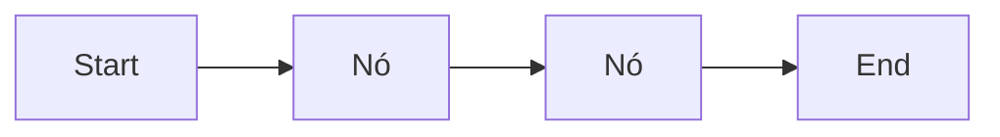

O `Start` declara as entradas que o fluxo pede.
Cada nó lê variáveis de nós anteriores e publica as próprias saídas.
O `End` escolhe as variáveis que o fluxo devolve.
Test Run executa o fluxo no editor, e a aba Last Run de cada nó mostra o que ele recebeu e devolveu.

---

## Tipos de entrada do Start

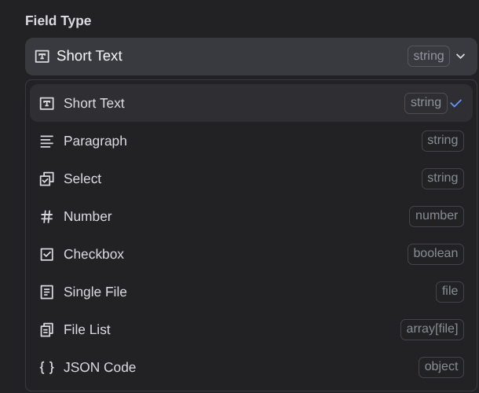

| Tipo | Variável |
|---|---|
| Short Text, Paragraph | `string` |
| Select | `string` |
| Number | `number` |
| Checkbox | `boolean` |
| Single File, File List | `file`, `array[file]` |
| JSON Code | `object` |

O formulário do Web App é gerado a partir desses campos.

---

## As etapas de um pipeline de dados

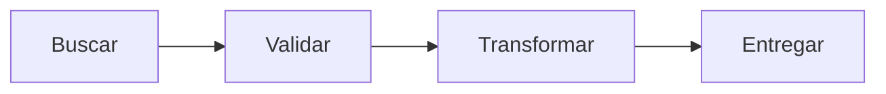

| Etapa | Nó do Dify |
|---|---|
| Buscar | `HTTP Request` chama a API |
| Validar | `Code` confere se a resposta tem os dados |
| Transformar | `Code` seleciona e calcula campos |
| Entregar | `End` devolve o JSON |

---

## Nó HTTP Request

Recebe método, URL, cabeçalhos, autenticação e corpo.
A URL aceita variáveis escolhidas no seletor, como o código do município.

| Saída | Conteúdo |
|---|---|
| `status_code` | Código HTTP da resposta |
| `body` | Corpo da resposta em texto |
| `headers` | Cabeçalhos da resposta |

O `body` chega como texto, e um nó `Code` converte o JSON com `JSON.parse`.

---

## Nó Code

Executa JavaScript ou Python em um sandbox, sem rede nem arquivos.
As entradas chegam como propriedades do objeto recebido por `main`.

```javascript
function main({ status_code, body }) {
  if (status_code !== 200) {
    return { ok: 0, nome: "" }
  }
  const dado = JSON.parse(body)
  if (Array.isArray(dado) && dado.length === 0) {
    return { ok: 0, nome: "" }
  }
  return { ok: 1, nome: dado.nome }
}
```

---

## O fluxo Município

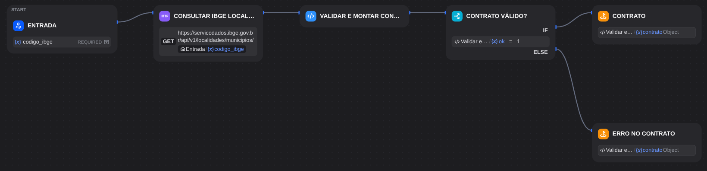

O `HTTP Request` consulta o IBGE e o `Code` valida a resposta.
O `If/Else` compara `ok` com `1` e escolhe a saída, `contrato` ou `erro`.
Dois `End` não podem devolver variáveis com o mesmo nome.

---

## Nó If/Else

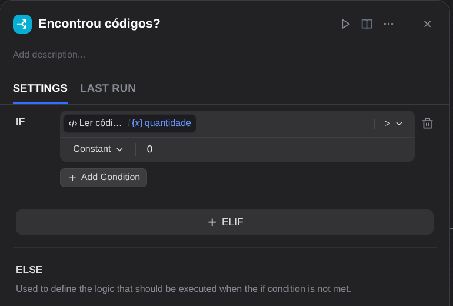

Cada caso reúne condições sobre variáveis de nós anteriores.

- `AND` exige todas as condições, e `OR` aceita qualquer uma.
- `ELIF` acrescenta um caso, testado quando o anterior falha.
- `ELSE` recebe a execução quando nenhum caso é aceito.

Cada ramo tem uma saída própria no canvas.

---

## Operadores de comparação

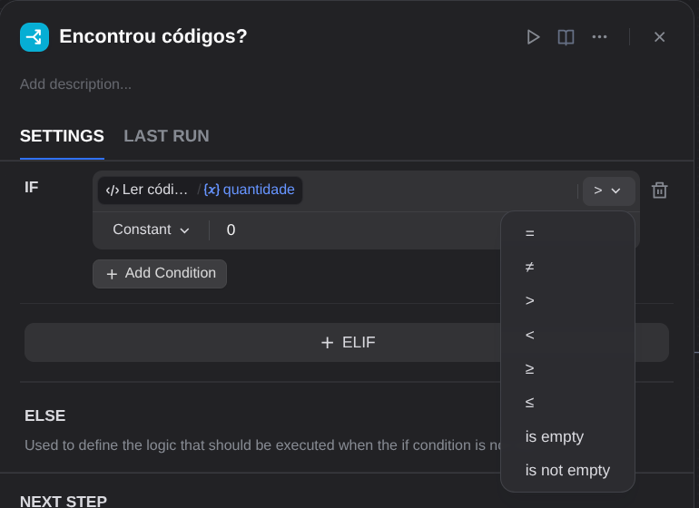

| Variável | Operadores |
|---|---|
| Número | `=` `≠` `>` `<` `≥` `≤` |
| Texto | contains, not contains, start with, end with, is, is not |
| Qualquer tipo | is empty, is not empty |

O valor da direita pode ser uma constante ou outra variável.

---

## Status 200 com lista vazia

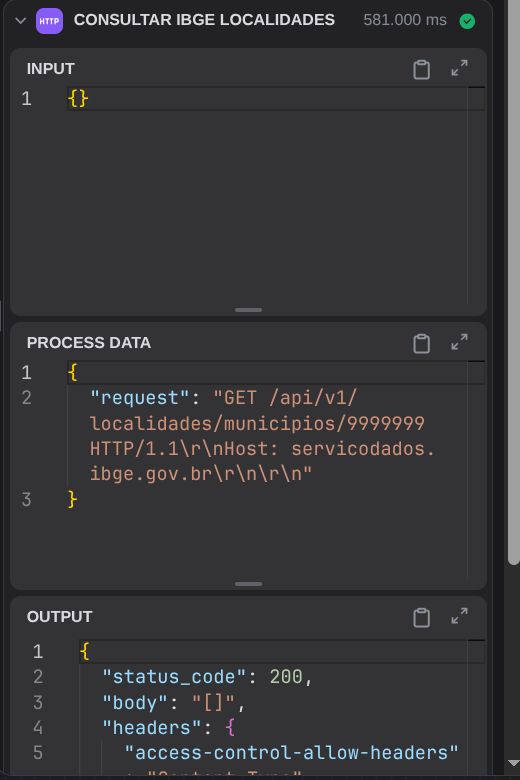

O código `9999999` não existe.

- A URL enviada termina em `9999999`.
- A API respondeu `status_code` `200`.
- O `body` é a lista vazia `[]`.
- O fluxo seguiu para "Erro no contrato".

---

## A condição lê o conteúdo

Uma condição sobre `status_code` mandaria a lista vazia para o ramo de sucesso.

O `Code` confere o corpo e devolve `ok`.
O `If/Else` decide pelo `ok`, calculado depois da validação.

| API | Status | Corpo com `9999999` |
|---|---|---|
| IBGE Localidades | `200` | `[]` |
| IBGE SIDRA | `500` | `{"statusCode":500,...}` |
| DataSUS CNES | `200` | `{"estabelecimentos": []}` |

---

## Anexar um arquivo ao fluxo

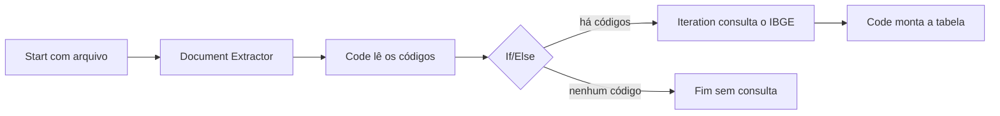

O fluxo recebe um CSV com códigos IBGE e consulta cada município.
A entrada é do tipo Single File, restrita a documentos.

---

## Document Extractor

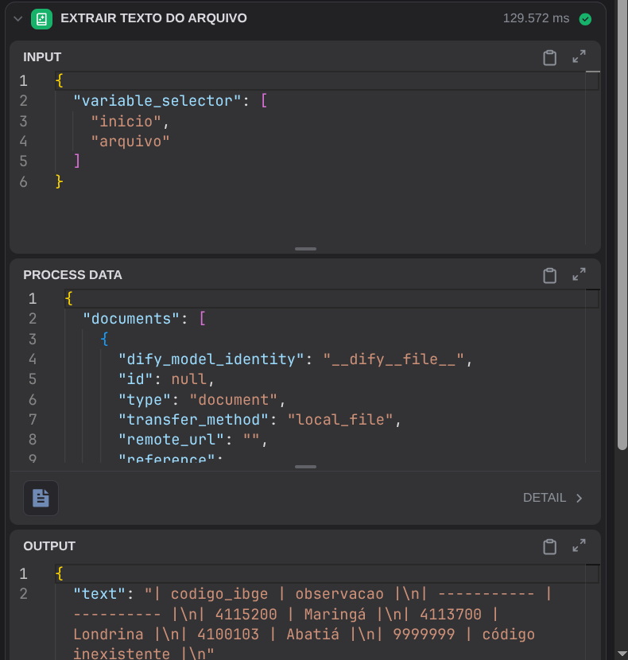

Lê uma variável do tipo `file` e devolve o conteúdo em `text`.

- Aceita TXT, Markdown, PDF com texto, DOCX, XLSX, CSV e PPTX.
- Planilhas e CSV chegam como tabela Markdown.
- Imagem, áudio e vídeo exigem outras ferramentas.

---

## Ler os códigos do texto

```javascript
function main({ texto }) {
  const codigos = texto.match(/\b\d{7}\b/g) || []
  return { codigos, quantidade: codigos.length }
}
```

A expressão regular procura números de 7 dígitos em qualquer coluna.
O `If/Else` testa `quantidade > 0`.
Um arquivo sem códigos termina no `ELSE`, sem chamar o IBGE.

---

## Nó Iteration

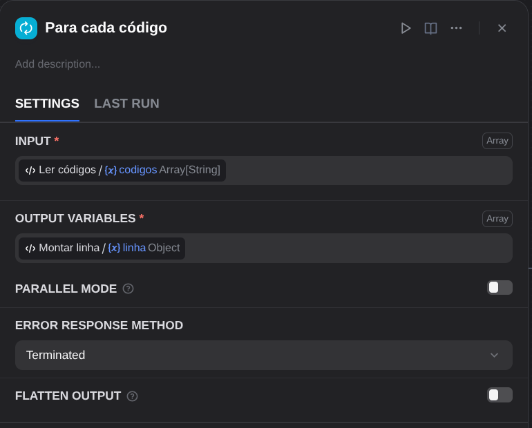

Recebe uma lista e executa os nós internos uma vez para cada elemento.

- `item` é o elemento atual, e `index` a posição a partir de 0.
- A saída reúne em uma lista o resultado de cada volta.
- O modo paralelo processa até 10 elementos ao mesmo tempo.

---

## O fluxo do CSV completo

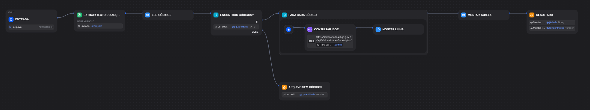

Em cada volta, o HTTP consulta o IBGE com `item` na URL e o `Code` monta uma linha.

Se um elemento falhar, Terminated interrompe a iteração.
Continue on error grava `null` no elemento, e Remove abnormal output o descarta.

---

## Publicar um workflow

Publish cria a versão em execução.
As edições seguintes ficam em rascunho até uma nova publicação.

| Acesso | Uso |
|---|---|
| Web App | Página com formulário gerado das entradas |
| Backend Service API | Chamada HTTP com chave |
| MCP Server | Ferramenta para agentes e aplicações de IA |
| Workflow as Tool | Nó dentro de outro app do Dify |

---

## Pontos de acesso

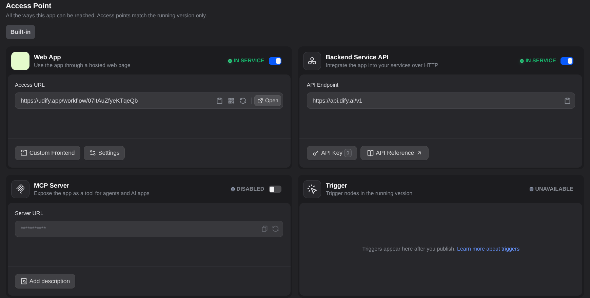

A página Access Point liga ou desliga cada forma de acesso.

---

## Web App

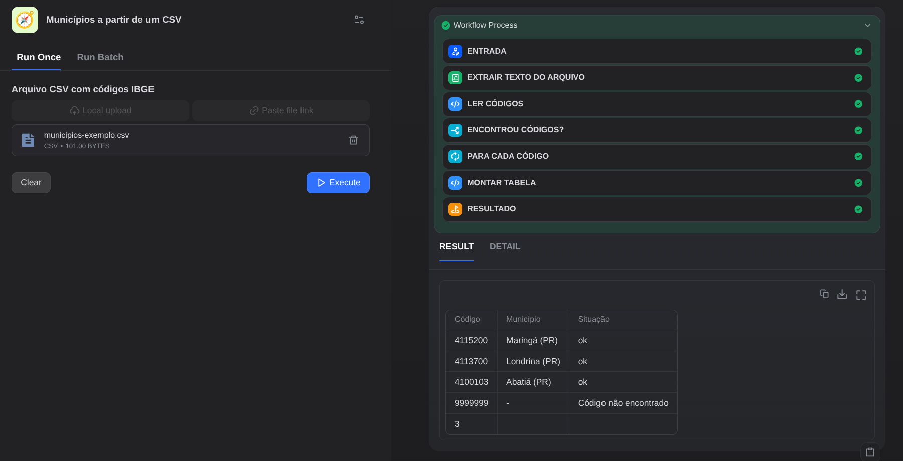

A URL abre um formulário com os campos do Start.
O campo Single File vira um botão de envio de arquivo.

A execução mostra os nós concluídos e o resultado.
O código `9999999` aparece na tabela como não encontrado.

---

## Publicar como API

Em Access Point, na seção Backend Service API, criar a chave em "API Key".

```text
POST https://api.dify.ai/v1/workflows/run
Authorization: Bearer <chave do fluxo>

{"inputs": {"codigo_ibge": "4115200"},
 "response_mode": "blocking", "user": "orquestrador"}
```

A resposta traz as saídas do `End` em `data.outputs`.

---

## A chave fica fora dos nós

O fluxo que chama outros guarda as chaves em variáveis de ambiente do tipo secreto.

| Variável | Fluxo chamado |
|---|---|
| `CHAVE_MUNICIPIO` | Município |
| `CHAVE_POPULACAO` | População |
| `CHAVE_SAUDE` | Saúde |

O nó HTTP usa `{{#env.CHAVE_MUNICIPIO#}}` na autenticação.
Os DSL da aula vêm com as variáveis vazias, e cada aluno cria as próprias chaves.

---

## Um workflow chama outro

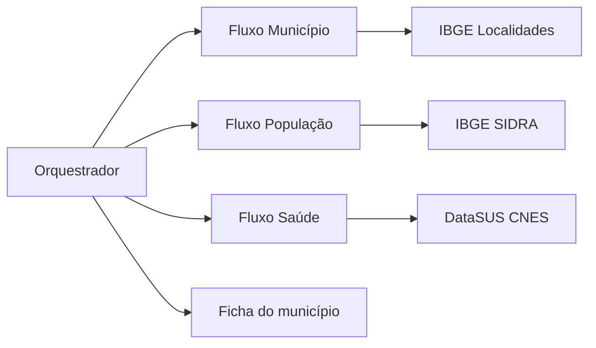

O orquestrador chama os três fluxos publicados pela API.
Ele junta as respostas em um único JSON, que os nós chamam de ficha do município.

---

## O contrato entre fluxos

Contrato é o formato combinado da saída de um fluxo, com nomes e tipos dos campos e o formato de erro.

```json
{"ok": true, "fonte": "IBGE Localidades",
 "codigo_ibge": "4115200",
 "dados": {"nome": "Maringá", "uf": "PR", "regiao": "Sul"}}
```

```json
{"ok": false, "fonte": "IBGE Localidades",
 "codigo_ibge": "9999999", "status_http": 200,
 "erro": "Município não encontrado"}
```

O orquestrador lê `ok` e os campos de `dados` pelo nome.

---

## O orquestrador

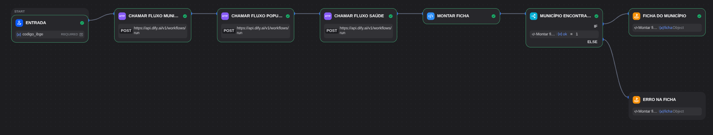

Três nós HTTP chamam os fluxos publicados.
Um `Code` monta a ficha e um `If/Else` confere se o município existe.

---

## Ler a resposta de outro fluxo

A API do Dify devolve o contrato dentro de `data.outputs`.

```javascript
function ler(status_code, body, etapa) {
  if (status_code !== 200) {
    return { ok: false, etapa, erro: `Fluxo respondeu HTTP ${status_code}` }
  }
  const saidas = JSON.parse(body).data.outputs
  return { etapa, ...(saidas.contrato || saidas.erro) }
}
```

O ramo de sucesso devolve `contrato`, e o ramo de erro devolve `erro`.
Uma chave errada chega como HTTP `401` nessa etapa.

---

## O resultado do orquestrador

```json
{"ok": true, "codigo_ibge": "4115200",
 "municipio": {"nome": "Maringá", "uf": "PR", "regiao": "Sul"},
 "populacao": {"populacao_2022": 409657, "crescimento_anual_pct": 1.19},
 "saude": {"unidades_basicas": 20, "pode_haver_mais": true},
 "habitantes_por_unidade_basica": null,
 "erros": []}
```

O CNES devolve no máximo 20 unidades por consulta, e `pode_haver_mais` marca esse limite.
Com a lista possivelmente incompleta, a divisão fica vazia.
Uma etapa com falha vai para `erros`, e as demais partes continuam.

---

## Gatilhos

Um gatilho ocupa o lugar do Start e dispara o fluxo sem formulário.

| Gatilho | Dispara quando |
|---|---|
| Webhook | Um sistema externo envia uma requisição HTTP para a URL do fluxo |
| Schedule | Chega o horário ou o intervalo configurado |
| Integration | Um serviço conectado por plugin gera um evento |

No plano gratuito, cada fluxo aceita até 2 gatilhos.
Com Schedule, o fluxo pode enviar um resumo diário sem que ninguém o acione.

---

## Gatilho Webhook

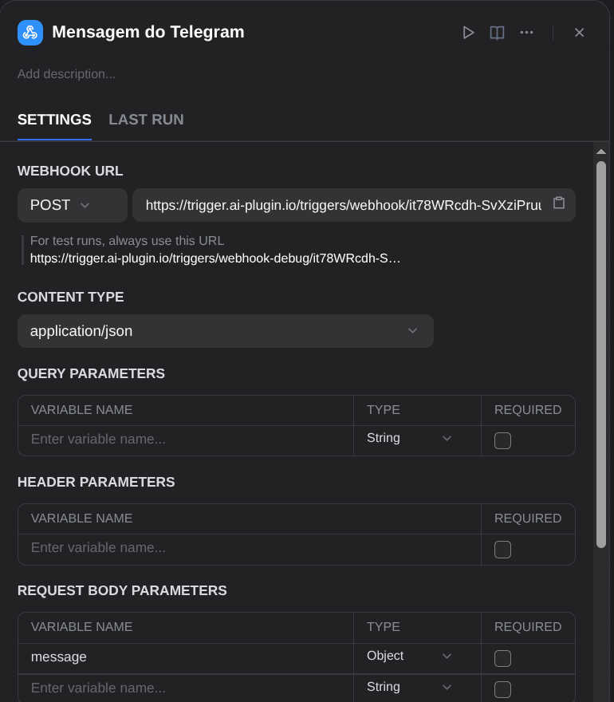

O Dify gera uma URL pública para a versão publicada e outra para testes.

- Campos do corpo, da query e dos cabeçalhos viram variáveis.
- Cada campo tem nome e tipo declarados.
- O Dify responde `200` ao receber a requisição e executa o fluxo em seguida.

---

## Bot de Telegram do município

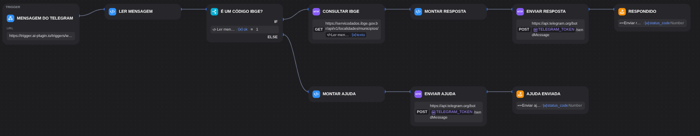

O Telegram envia cada mensagem recebida pelo bot à URL do Webhook.
O fluxo consulta o IBGE e responde pela API do Telegram.
Uma mensagem que não é código IBGE segue pelo `ELSE` e recebe instruções.

---

## Ler a mensagem do Telegram

```javascript
function main({ message }) {
  const texto = (message && message.text ? message.text : "").trim()
  const chat_id = message && message.chat ? String(message.chat.id) : ""
  const ok = /^\d{7}$/.test(texto) ? 1 : 0
  return { texto, chat_id, ok }
}
```

O Webhook declara o campo `message`, do tipo objeto.
`chat.id` identifica a conversa que recebe a resposta.

---

## Responder pela API do Telegram

```text
POST https://api.telegram.org/bot<token>/sendMessage
Content-Type: application/json

{"chat_id": "123456789", "text": "Maringá (PR), região Sul."}
```

O token fica na variável de ambiente secreta `TELEGRAM_TOKEN`.
O `Code` monta o corpo com `JSON.stringify`, que preserva aspas e acentos do texto.

---

## Criar e ligar o bot

1. No Telegram, enviar `/newbot` para @BotFather e guardar o token.
2. Importar o DSL do bot, preencher `TELEGRAM_TOKEN` e publicar.
3. Abrir no navegador o endereço abaixo, com a URL do Webhook.
4. Enviar `4115200` para o bot.

```text
https://api.telegram.org/bot<token>/setWebhook?url=<URL do Webhook>
```

---

## Logs de execução

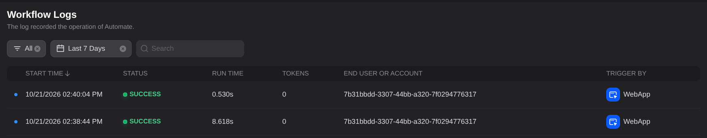

Cada execução fica registrada com status, tempo, tokens e origem, como Web App ou API.
O detalhe da execução mostra a entrada e a saída de cada nó na aba Tracing.

---

## Versões e DSL

O histórico de versões lista as publicações do fluxo.

O DSL é o fluxo exportado em YAML, com nós, ligações e variáveis.
Importar o DSL recria o fluxo em outra conta.
Os DSL da aula foram exportados sem os valores das variáveis secretas.

---

## Quando um script resolve melhor

O nó `Code` executa um trecho por nó, dentro do sandbox.

- Regras extensas ficam espalhadas entre vários nós.
- Testar uma regra exige executar o fluxo inteiro.
- A diferença entre duas versões aparece como YAML do DSL.

Regras complexas cabem em código versionado e testado.
O fluxo pode chamar esse código por HTTP, como chama as APIs públicas.

---

## Para estudar mais

Dify e APIs públicas usadas na aula.

- [Publicar um workflow como API no Dify](https://docs.dify.ai/en/guides/application-publishing/developing-with-apis)
- [Nó If/Else](https://docs.dify.ai/en/cloud/use-dify/nodes/ifelse), [Document Extractor](https://docs.dify.ai/en/cloud/use-dify/nodes/doc-extractor) e [Iteration](https://docs.dify.ai/en/cloud/use-dify/nodes/iteration)
- [Gatilhos](https://docs.dify.ai/en/cloud/use-dify/nodes/trigger/overview), [Webhook](https://docs.dify.ai/en/cloud/use-dify/nodes/trigger/webhook-trigger) e [API de bots do Telegram](https://core.telegram.org/bots/api)
- [Nó HTTP Request](https://docs.dify.ai/en/cloud/use-dify/nodes/http-request) e [Nó Code](https://docs.dify.ai/en/cloud/use-dify/nodes/code)
- [API de localidades do IBGE](https://servicodados.ibge.gov.br/api/docs/localidades) e [API de agregados do IBGE](https://servicodados.ibge.gov.br/api/docs/agregados?versao=3)
- [API de dados abertos do Ministério da Saúde](https://apidadosabertos.saude.gov.br/)
