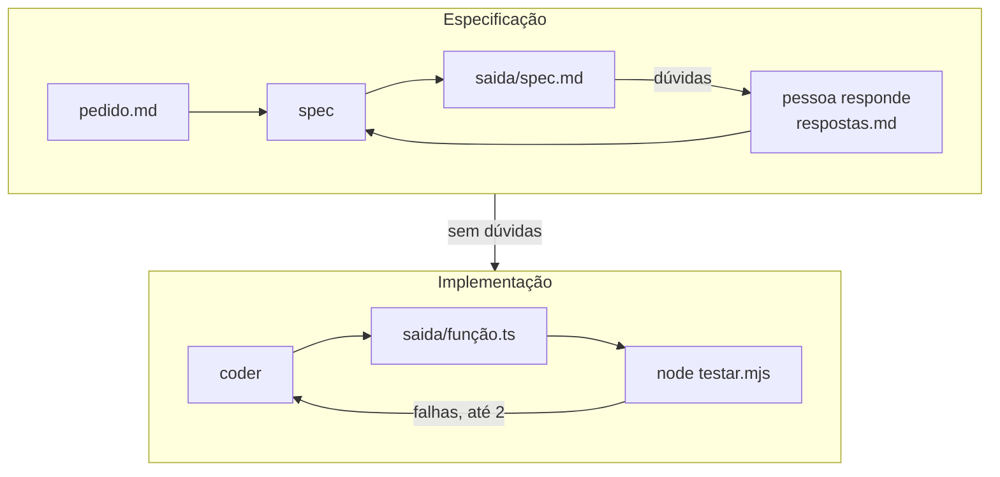
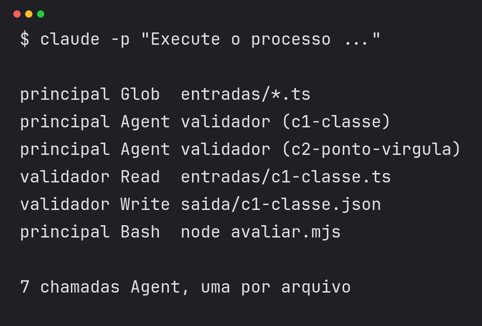
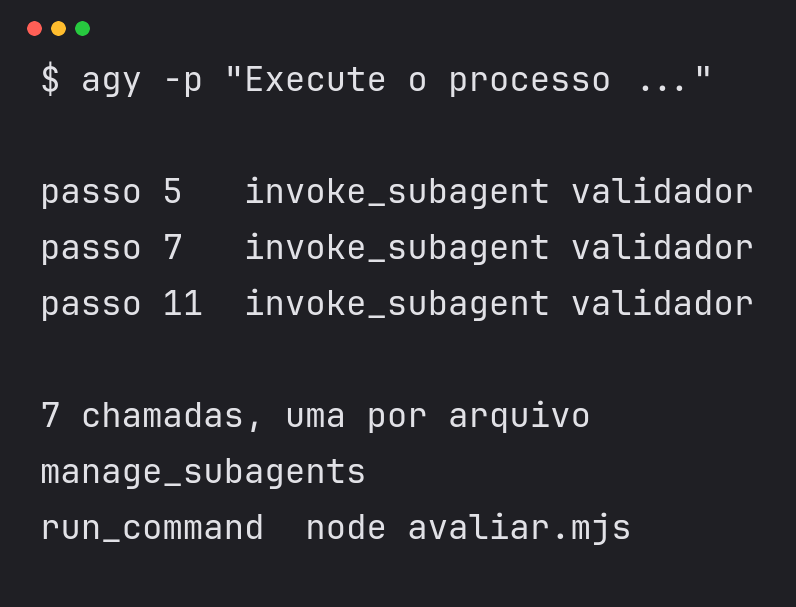

# Criar agentes no harness
## Agentes nos três harnesses

---

## Um agente é um arquivo no projeto

O harness lê a pasta de agentes ao abrir a sessão.
A conversa principal delega uma etapa ao agente, que roda com contexto próprio, recebe só o texto da delegação e devolve um resumo.

| Campo | Função |
|---|---|
| `name` | Nome usado na delegação |
| `description` | Texto que a conversa principal lê para escolher o agente |
| `tools` | Ferramentas que o agente pode usar |
| Instruções | Papel, arquivos de entrada e de saída e regras |

---

## Onde fica cada agente

| Harness | Agentes no projeto | Regras | Pasta pessoal |
|---|---|---|---|
| Antigravity | `.agents/agents/*.md` | `AGENTS.md` | `~/.gemini/config/agents/` |
| Codex | `.codex/agents/*.toml` | `AGENTS.md` | `~/.codex/agents/` |
| Claude Code | `.claude/agents/*.md` | `CLAUDE.md` | `~/.claude/agents/` |

As pastas ficam dentro de `criar-agentes/`. O harness identifica o agente pelo `name`, e não pelo nome do arquivo.
Sessão aberta antes de criar o arquivo não enxerga o agente novo. Feche e abra de novo.

---

## O agente spec no Claude Code

```markdown
---
name: spec
description: Escreve a especificação com critérios e dúvidas.
  Use antes de qualquer implementação.
tools: Read, Write
---

Leia pedido.md e respostas.md. Grave saida/spec.md com as seções
Critérios (C01, C02...) e Dúvidas. Use as respostas nos critérios
e copie as mensagens de erro exatamente. Sem dúvidas, escreva Nenhuma.
Não escolha respostas nem escreva código.
```

As versões do Antigravity e do Codex ficam na seção de consulta, depois do fim do bloco.

---

## A descrição decide a delegação

A conversa principal vê o `name` e a `description` de cada agente, como o modelo vê a descrição de uma ferramenta no tool calling e no MCP. As instruções só chegam ao agente depois da chamada.

| Descrição | Efeito |
|---|---|
| "Escreve a especificação do pedido. Use antes de qualquer implementação." | A conversa principal chama o spec no começo |
| "Ajuda no projeto." | A conversa principal não sabe quando chamar e escreve sozinha |

O Claude Code delega pela descrição. O Codex delega quando você pede ou quando o `AGENTS.md` manda.

---

## Ferramentas por agente

spec e coder só leem e gravam arquivos. Quem roda `node testar.mjs` é a conversa principal, conforme as regras.

| Ação | Claude Code | Antigravity |
|---|---|---|
| Ler arquivo | `Read` | `view_file` |
| Criar arquivo | `Write` | `write_to_file` |
| Alterar um trecho | `Edit` | `replace_file_content` |
| Executar comando | `Bash` | `run_command` |

No Codex, `features.shell_tool = false` desliga o shell, e `.codex/rules/` libera ou bloqueia comandos.

---

## O agente coder

```markdown
---
name: coder
description: Implementa percentualConcluido a partir de saida/spec.md.
tools: Read, Write
---

Leia saida/spec.md e pedido.md. Grave saida/percentualConcluido.ts.
Funções puras, sem classes, sem ponto e vírgula, sem alterar a entrada.
Mensagens de erro exatamente como na especificação.
Com falhas de testes, corrija o comportamento de cada uma.
```

O coder lê o pedido, onde está a assinatura. As mensagens de erro chegam pela especificação.

---

## As regras coordenam o processo

`AGENTS.md` e `CLAUDE.md` entram no contexto da conversa principal no início da sessão, sem gatilho.

```text
1. Delegue ao subagent spec. Passe apenas o caminho pedido.md.
2. Se o spec devolver dúvidas, mostre-as à pessoa e espere.
3. Com respostas.md preenchido e sem dúvidas, delegue ao coder.
4. Rode o comando node testar.mjs.
5. Se algum caso falhar, envie as falhas ao coder. No máximo duas.
6. Informe os critérios, o resultado dos testes e as falhas.
```

---

## O processo com spec e coder



---

## O kit da aula

```bash
git clone https://github.com/pedrosatin/processo-software-agentes.git
cd processo-software-agentes/criar-agentes
node pedido.mjs exemplo
```

Crie os arquivos dos agentes spec e coder em `criar-agentes/`, abra o harness (`agy`) e peça `Execute o processo de desenvolvimento para pedido.md.`
O harness pede permissão para gravar em `saida/` e rodar `node testar.mjs`. Aprove, ou o processo para antes de delegar.

---

## O spec para nas dúvidas

Na primeira execução, `respostas.md` está vazio. O spec grava as dúvidas em `saida/spec.md`, e a conversa principal as mostra e espera.

- O resultado vai de 0 a 100 ou de 0 a 1?
- Lista vazia retorna 0, 100 ou erro?
- Uma de três concluídas retorna 33,33, 33 ou 0,33?

As respostas de quem fez o pedido ficam em `pedidos/E/respostas.md`. Depois de copiá-las, peça `Preenchi respostas.md. Execute o processo de desenvolvimento para pedido.md.`

---

## Conferir a delegação

<style scoped>
table { font-size: 0.8em; }
</style>

| Harness | O que aparece na tela | Como listar os agentes |
|---|---|---|
| Claude Code | Chamada `Agent` com o nome do agente | `/tasks` |
| Antigravity | Chamada `invoke_subagent` com o tipo do agente | `/agents` |
| Codex | Subagent criado com o nome do papel | `/subagents` |

A mensagem final do modelo não comprova a delegação. Confira a chamada ao agente e a saída de `node testar.mjs`.

---

## A delegação na tela

 

Ensaio de 04/11 com o validador, em modo `-p`. O Claude Code mostra `Agent`, e o Antigravity mostra `invoke_subagent`. No modo interativo a linha é parecida. No Codex, use `/subagents`.

---

## Casos de referência e taxa de acerto

```text
ok    lista vazia
ok    uma de duas
ok    uma de três
ok    duas de três
ok    todas concluídas
ok    nenhuma concluída

6 de 6 casos aprovados
```

O spec escreveu 14 critérios e os casos cobrem 6. Os critérios sem caso não entram na taxa.
Nenhum caso usa 29 de 200. Um código com `29 / 200 * 100` passa 6 de 6 e devolve 14, e o spec decidiu 15.

---

## Acerto, falsos positivos e negativos

| Medida | Pergunta |
|---|---|
| Caso exato | O agente acertou tudo no caso? |
| Falso positivo | Ele apontou algo que não existe? |
| Falso negativo | Ele deixou passar algo que existe? |
| Precisão | Dos itens apontados, quantos estão certos? |
| Cobertura | Dos itens esperados, quantos ele apontou? |

O avaliador conta por item: um achado extra é falso positivo, e um achado que falta é falso negativo. Uma taxa de acerto sozinha esconde o tipo de erro.

---

## Para estudar mais

Documentação dos agentes em cada harness.

- [Subagents no Claude Code](https://code.claude.com/docs/en/sub-agents) e [ferramentas](https://code.claude.com/docs/en/tools-reference)
- [Subagents no Codex](https://learn.chatgpt.com/docs/agent-configuration/subagents) e [AGENTS.md no Codex](https://learn.chatgpt.com/docs/agent-configuration/agents-md)
- [Subagents no Antigravity](https://antigravity.google/docs/subagents/), [comando /agents](https://antigravity.google/docs/cli/commands/agents/) e [instalação do CLI](https://antigravity.google/docs/cli/)
- [Formato AGENTS.md](https://agents.md)
- [Kit da aula](https://github.com/pedrosatin/processo-software-agentes/tree/main/criar-agentes)

---

# Consulta sobre agentes
## Instalação, campos, exemplos e problemas

---

## Antes de começar

<style scoped>
table { font-size: 0.8em; }
</style>

| Harness | Instalação e login | Custo |
|---|---|---|
| Antigravity (`agy`) | Instruções em antigravity.google/docs/cli e login com conta Google | Sem custo, com cota semanal |
| Codex | `npm install -g @openai/codex` e login com a conta ChatGPT | Depende do plano da conta |
| Claude Code | Instalação e login pela documentação do Claude Code | Plano pago ou crédito de API |

Confira com `agy --version`, `codex --version` ou `claude --version`.
Sem harness instalado, acompanhe pela tela do professor e escreva os arquivos dos agentes mesmo assim.

---

## Campos de cada harness

<style scoped>
table { font-size: 0.72em; }
</style>

| | Antigravity | Codex | Claude Code |
|---|---|---|---|
| Formato | Markdown e YAML | TOML | Markdown e YAML |
| Obrigatórios | name, description | name, description, developer_instructions | name, description |
| Ferramentas | tools, em lista | sem lista por nome | tools e disallowedTools |
| Modelo | inherit, flash, pro | model e model_reasoning_effort | sonnet, opus, haiku |
| Permissões | commandExecutionPolicy | sandbox da sessão e regras em `.codex/rules/` | permissionMode |

Os campos completos de cada harness ficam no `README.md` do kit, e os links no slide "Para estudar mais" do bloco.

---

## O mesmo spec no Antigravity

```markdown
---
name: spec
description: Escreve a especificação com critérios e dúvidas.
  Use antes de qualquer implementação.
tools:
  - view_file
  - write_to_file
subagent: true
mainAgent: false
---

Mesmas instruções do Claude Code, abaixo do cabeçalho.
```

As ferramentas usam os nomes do Antigravity. O coder leva também `replace_file_content`, para corrigir o arquivo.

---

## O mesmo spec no Codex

```toml
name = "spec"
description = "Escreve a especificação com critérios e dúvidas."
developer_instructions = """
Leia pedido.md e respostas.md. Grave saida/spec.md com as seções
Critérios (C01, C02...) e Dúvidas. Use as respostas nos critérios
e copie as mensagens de erro exatamente. Sem dúvidas, escreva Nenhuma.
Não escolha respostas nem escreva código.
"""
```

O Codex só lê `.codex/agents/` depois que você aceita confiar na pasta.

---

## Um spec pronto

```markdown
## Critérios

C01. Todas concluídas retorna 100, e não 1.
C03. Lista vazia retorna 0.
C05. Math.round(concluidas * 100 / total): uma de três retorna 33.
C07. 29 de 200 concluídas retorna 15.
C13. A lista recebida não é alterada.

## Dúvidas

Nenhuma.
```

Trecho de um spec com 14 critérios. Em 29 de 200, `29 / 200 * 100` dá 14 e `29 * 100 / 200` dá 15, e o spec perguntou qual vale.

---

## Exemplo de agente de validação

<style scoped>
table { font-size: 0.8em; }
</style>

O `validador` lê um arquivo TypeScript e grava `saida/<caso>.json` com `ok` e `achados`. São sete arquivos em `exemplos/validacao`.

| Caso | Esperado |
|---|---|
| Um defeito: classe, `;`, `any` ou altera a entrada | Um achado cada |
| Classe e `any` juntos | Dois achados |
| Correto, ou armadilha com `class`, `any` e `;` em texto | Nenhum |

```json
{"agente": "validador", "ok": false, "achados": ["usa-classe"]}
```

---

## Resultados dos exemplos

<style scoped>
table { font-size: 0.8em; }
</style>

| Agente | Harness e modelo | Casos exatos | Falsos positivos | Falsos negativos |
|---|---|---|---|---|
| validador | Claude Code, `haiku` | 7 de 7 | 0 | 0 |
| validador | Codex, modelo padrão | 7 de 7 | 0 | 0 |
| validador | Antigravity, modelo padrão | 7 de 7 | 0 | 0 |
| documentador | Claude Code, `haiku` | 4 de 4 | 0 | 0 |

Os modelos são diferentes, então a tabela não compara os harnesses. Com 7 casos, 7 de 7 não prova que o agente acerta sempre. O tempo médio não foi medido.

---

## Quando o agente erra

```text
ok         c1-classe          esperado [usa-classe]
erro       c4-altera-entrada  falso negativo: altera-entrada
erro       c6-armadilha       falso positivo: usa-classe, tipo-any
sem saída  c7-duas-violacoes  falso negativo: usa-classe, tipo-any

Casos exatos: 4 de 7 (57%)
Falsos positivos: 2. Falsos negativos: 3.
Precisão: 60%. Cobertura: 50%.
```

Saídas alteradas à mão para mostrar o aviso. Um caso sem saída conta como erro, e `avaliar.mjs` termina com código 1.
A marca `agente` na saída ajuda a notar quem escreveu o arquivo, mas qualquer pessoa pode escrevê-la.

---

## Problemas comuns

<style scoped>
table { font-size: 0.75em; }
</style>

| Sintoma | Causa provável |
|---|---|
| "O agente spec não existe" | Arquivo fora de `criar-agentes/`, `name` errado ou sessão aberta antes |
| Codex ignora os agentes | Pasta ainda não marcada como confiável |
| O harness para pedindo permissão | Falta aprovar a gravação em `saida/` e o `node testar.mjs` |
| A conversa principal escreve o código | Descrição vaga ou regras apagadas |
| O coder grava outro arquivo | Instruções ainda citam a função do exemplo |
| `[falhou]` na evidência | A linha "O que fazer" abaixo dele diz a causa |
