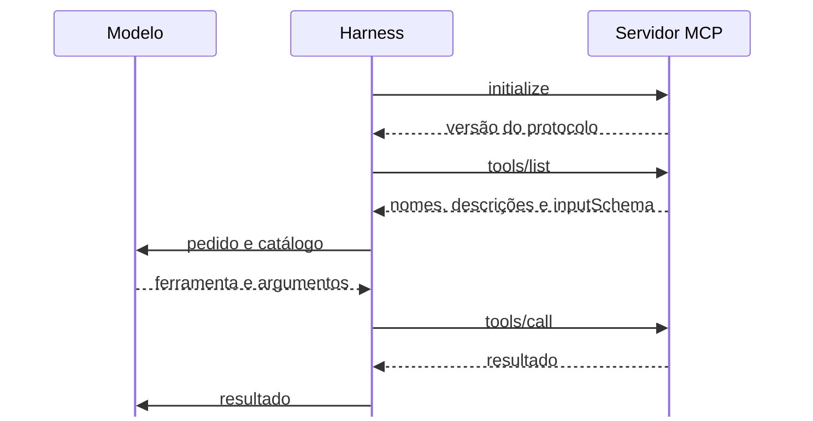

# Resolução da atividade de agentes
## O que as execuções mostraram

---

## O agente que o harness não encontra

| Sintoma | Causa | Correção |
|---|---|---|
| `spec` não encontrado | Pasta `agents` sem `.agents` antes | Usar `.agents/agents/` dentro de `criar-agentes` |
| Pasta do Codex ignorada | `codex` escrito sem o ponto | Usar `.codex/agents/` |
| Cabeçalho ignorado | Linha em branco antes do primeiro `---` | Começar o arquivo em `---` |
| Cabeçalho ignorado no Windows | Arquivo gravado com BOM, bytes invisíveis no início | Regravar em UTF-8 sem BOM |
| `MODULE_NOT_FOUND` | `node` executado em outra pasta | Entrar em `criar-agentes` |

---

## Resolução em quatro etapas

| Etapa | O que conferir |
|---|---|
| Criar `spec` e `coder` | `name`, `description` e instruções em cada arquivo |
| Executar o processo | Chamada ao `spec` visível na tela |
| Responder às dúvidas | `respostas.md` preenchido antes da retomada |
| Retomar e gerar a evidência | Chamada ao `coder`, seis casos e `node evidencia.mjs` |

A conversa principal coordena. Cada agente lê e grava os arquivos das suas instruções.

---

## As dúvidas do spec

O spec lista as decisões que o pedido deixou em aberto, como ids repetidos, ordem do resultado e entrada inválida. Quantidade alta de dúvidas indica um pedido com lacunas.

As respostas do pedido cobrem parte dessas decisões. A dúvida sem resposta pede uma decisão sua, escrita em `respostas.md`. Depois disso, o critério da especificação registra essa decisão.

---

## As dúvidas no Workflow e no harness

O Workflow de spec, coder e tester no Dify e os agentes criados no harness param no mesmo ponto.

| Etapa | Workflow no Dify | Agentes no harness |
|---|---|---|
| O spec registra as dúvidas | Saída JSON lida pelo nó `Code` | Dúvidas gravadas em `saida/spec.md` |
| O processo para | `If/Else` desvia para um nó `End`, que devolve as dúvidas | A regra manda mostrar as dúvidas e esperar |
| As respostas voltam | Campo `respostas` em uma nova execução | `respostas.md` preenchido antes da retomada |

Nos dois casos, o coder só entra quando a especificação fica sem dúvidas pendentes.

---

## O que os casos de referência medem

Seis casos aprovados mostram o comportamento da função nessas seis entradas. Uma entrada fora da lista continua sem verificação.

O resultado esperado foi definido antes da execução. Essa ordem permite comparar o que o agente entregou com um critério que não depende da resposta dele.

A conferência do contrato de ferramentas, no laboratório de hoje, usa a mesma ordem.

---

# MCP no processo com agentes
## Descoberta, chamada e contrato

---

## Duas descrições orientam o modelo

| | Descrição do agente | Descrição da ferramenta |
|---|---|---|
| Onde fica | `description` no arquivo do agente | `description` no catálogo do servidor MCP |
| O que o modelo decide | Para qual agente delegar | Qual ferramenta chamar |
| Exemplo | Escreve a especificação com critérios e dúvidas. | Consulta os dados de uma sala pelo id, sem alterar nada. |

A atividade de agentes treinou a primeira. O laboratório de hoje treina a segunda.

---

## O harness é o cliente MCP



`initialize` apresenta os dois lados e combina a versão. O `tool_use` do modelo vira o `tools/call` enviado pelo harness.

---

## O catálogo em tools/list

O contrato de cada ferramenta tem nome, descrição e `inputSchema`. O cliente o descobre sem conhecer o servidor antes. As mensagens seguem o JSON-RPC, em que `method` diz a operação e `id` liga a resposta ao pedido.

```json
{ "jsonrpc": "2.0", "id": 2, "method": "tools/list" }
```

```json
{ "jsonrpc": "2.0", "id": 2, "result": { "tools": [
  { "name": "consultar_sala",
    "description": "Consulta os dados de uma sala pelo id, sem alterar nada.",
    "inputSchema": { "type": "object", "required": ["id"],
      "properties": { "id": { "type": "integer" } } } }
] } }
```

---

## A chamada em tools/call

O nome e os argumentos seguem o que o catálogo informou. O resultado vem como texto, e neste servidor o texto é um JSON.

```json
{ "jsonrpc": "2.0", "id": 3, "method": "tools/call",
  "params": { "name": "consultar_sala", "arguments": { "id": 101 } } }
```

```json
{ "jsonrpc": "2.0", "id": 3, "result": {
  "content": [ { "type": "text",
    "text": "{\"id\":101,\"nome\":\"Sala Ada\",\"total\":0}" } ],
  "isError": false } }
```

---

## Dois tipos de erro em uma chamada

Em `error`, o pedido nem chega a uma ferramenta. Em `isError`, a ferramenta foi acionada e recusou os dados ou falhou.

| Situação | Onde aparece | Exemplo |
|---|---|---|
| Falha de protocolo | Campo `error`, com código numérico | Ferramenta inexistente, código `-32602` |
| Falha na execução da ferramenta | `result` com `isError: true` | Argumentos recusados pelo servidor |

Resposta sem `error` pode trazer `isError: true`, então o cliente lê o resultado, como o nó `Code` lia o corpo do HTTP no Dify. O modelo recebe esse texto e pode corrigir a chamada.

---

## A descrição orienta a escolha

O modelo lê a descrição para decidir qual ferramenta chamar. Uma boa descrição diz o que a ferramenta devolve ou muda e quando chamá-la.

| Ferramenta | Descrição fraca | Descrição útil |
|---|---|---|
| `consultar_sala` | Executa a operação. | Consulta os dados de uma sala pelo id, sem alterar nada. Para reservar, use `reservar_sala`. |
| `reservar_sala` | Executa a operação. | Reserva a sala e atualiza o total de horas. Use quando o pedido mandar reservar. |

Descrições iguais removem essa pista. O nome, os argumentos e o contexto continuam influenciando a escolha.

---

## O inputSchema define a entrada

```json
{
  "type": "object",
  "properties": {
    "id": { "type": "integer", "minimum": 1 },
    "horas": { "type": "integer", "minimum": 1, "maximum": 4 }
  },
  "required": ["id", "horas"],
  "additionalProperties": false
}
```

`type` aceita `integer`, `number`, `string` e `boolean`. `minimum` e `maximum` limitam números. `required` fica ao lado de `properties` e lista os obrigatórios. `additionalProperties: false`, opcional, recusa campos fora da lista.

---

## O mesmo pedido com e sem schema

Pedido enviado ao Antigravity, com limite de 4 horas: *Reserve a sala 105, com horas igual a 5.*

| Contrato | O modelo enviou | Resposta do servidor |
|---|---|---|
| `inputSchema` vazio | `id` 105 e `horas` 5 | `isError: false`, total igual a 5 |
| Schema com `maximum` 4 | `id` 105 e `horas` 5 | `isError: true`, `Argumentos inválidos: horas precisa ser no máximo 4.` |

O modelo enviou 5 nas duas execuções. O harness repassou a chamada, e o servidor validou antes de executar. Sem validação no servidor, o schema publicado deixa o limite sem efeito.

---

## Um servidor para vários clientes

O mesmo servidor atendeu aos três harnesses sem alteração. O registro de chamadas guardou os nomes informados no `initialize`: `antigravity-client`, `claude-code` e `codex-mcp-client`.

A integração com o sistema fica em um lugar só. Uma correção no servidor chega aos clientes na próxima conexão, e um cliente novo descobre o catálogo por `tools/list`, sem código de integração próprio.

---

## Para estudar mais

* [Ferramentas na especificação do MCP](https://modelcontextprotocol.io/specification/2025-11-25/server/tools): `tools/list`, `tools/call` e erros de execução.
* [Transportes do MCP](https://modelcontextprotocol.io/specification/2025-11-25/basic/transports): stdio e o uso exclusivo do stdout para mensagens.
* [JSON Schema](https://json-schema.org/understanding-json-schema/): tipos, `required` e limites numéricos.
* [MCP no Antigravity](https://antigravity.google/docs/mcp/), [no Claude Code](https://code.claude.com/docs/en/sub-agents#scope-mcp-servers-to-a-subagent) e [no Codex](https://learn.chatgpt.com/docs/extend/mcp?surface=cli): registro do servidor em cada harness.

---

# Consulta
## Servidor no agente, codificação e terminal

---

## Servidor MCP no arquivo do agente

O arquivo do agente pode listar os servidores MCP que ele usa. Nenhum laboratório desta aula precisa disso.

```yaml
---
name: atendente
description: Consulta salas e registra reservas. Use em pedidos sobre salas.
mcpServers:
  - aula
---
Use as ferramentas do servidor aula. Informe o resultado de cada chamada.
```

Formato do Claude Code. No Antigravity, `inheritMcp` controla a herança dos servidores. No Codex, o agente herda os da sessão.

---

## O BOM no Windows PowerShell

`Set-Content -Encoding utf8` grava os bytes `EF BB BF` no início do arquivo. O texto deixa de começar em `---`, e o harness não encontra o cabeçalho do agente.

```powershell
$semBom = New-Object System.Text.UTF8Encoding($false)
[IO.File]::WriteAllText($caminho, $texto, $semBom)
```

Editores como o VS Code mostram a codificação na barra inferior. A opção correta é `UTF-8`, e `UTF-8 with BOM` causa essa falha.

---

## Terminal e instalação no Windows

| Sintoma | Correção |
|---|---|
| Ctrl+K do Antigravity abre outro atalho no VS Code | Abrir `agy` no PowerShell ou no Prompt de Comando |
| Pedido de aprovação expira no terminal do VS Code | Abrir `agy` fora do VS Code |
| `Filename too long` no `git clone` | `git -c core.longpaths=true clone <url>` |
| Sessão aberta antes de criar o agente | Fechar e abrir a sessão |
